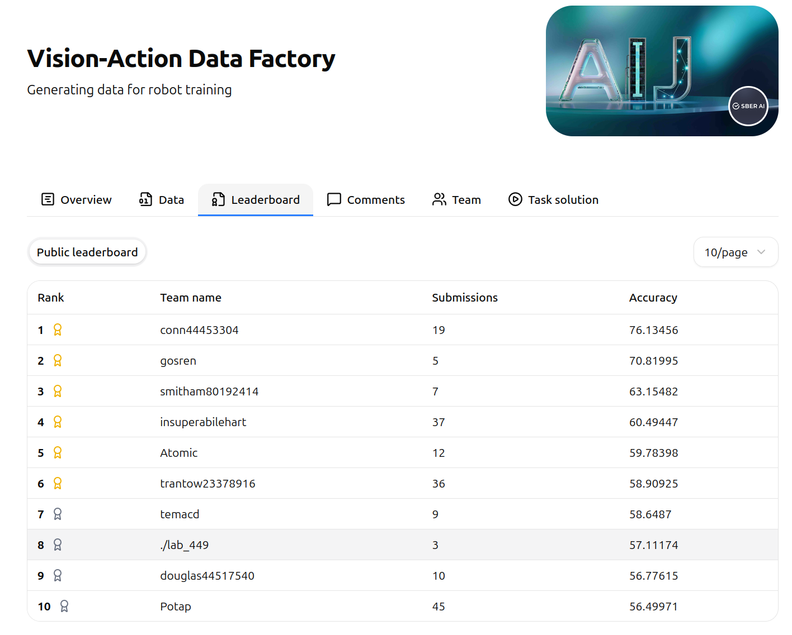

# AIJ 2026 Task 4: Vision-Action Data Factory

Repository of the **./lab_449** team for the AIJ 2026 robotics track. A generator turns raw robot episodes (Bridge, Fractal) into ~14k
ShareGPT VQA records aimed at what the VLM benchmarks test. That data fine-tunes SmolVLM2-500M, and the fine-tuned
VLM then initialises a SmolVLA policy trained on LIBERO.

The submitted version is on `main`; `submission/README.md` describes it in detail (sources, models, how to reproduce).

On the public leaderboard ./lab_449 placed 8th with 57.11, using 3 submissions:



## Generator

`submission/generate_dataset.py` runs three sources, set up in `submission/config.yaml`:

| Source | Questions | Models |
|---|---|---|
| `scene_qa` | object relations, closest/farthest object, pointing, box localisation, existence, counting | SAM 3 + Depth Anything 3 |
| `depth_tier1` | BLINK-style "which point is closer" pairs and 3–4 point sets | Depth Anything 3 + SAM 2.1 |
| `phase_qa` | grasp phase, from the measured gripper state | none |

Each source is capped, answer letters are balanced, and everything is seeded, so the same inputs give the same output.

## Layout

| Path | What |
|---|---|
| `submission/` | the deliverable: generator code and config, self-contained (no imports from `tools/` or `vendor/`) |
| `configs/` | generator, VLM SFT (`vlm_sft/`) and VLA (`vla/`) experiment configs |
| `tools/` | dev scripts: data download, packing and offline verification, inspection probes (see `tools/README.md`) |
| `tests/` | unit tests for the generator and the packer |
| `docs/` | plan, organizer rules and Q&A, metric notes |
| `vendor/` | organizer code as released: training/eval kit, baseline pipeline, demo submission |

`data/`, `runs/` and `artifacts/` hold datasets, checkpoints and built ZIPs; they are not tracked.

## Usage

```bash
# dev container from the organizers' image (see compose.yaml)
cp .env.example .env && docker compose up -d --build && docker compose exec dev bash

# raw data, then the dataset
python tools/fetch_data.py
python submission/generate_dataset.py --input /data/raw --output /data/gen/<name> --config submission/config.yaml

# train with the kit in vendor/participant/ using a config from configs/, then pack the ZIP
python tools/pack_submission.py --name <name> --from runs/<run>/submission --annotations /data/gen/<name>/annotations.jsonl

# on the host: check the ZIP in a fresh offline container from the organizers' image
tools/verify_submission.sh artifacts/<name>.zip --libero

# tests
python -m unittest discover -s tests
```
